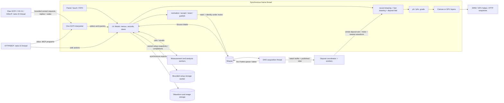
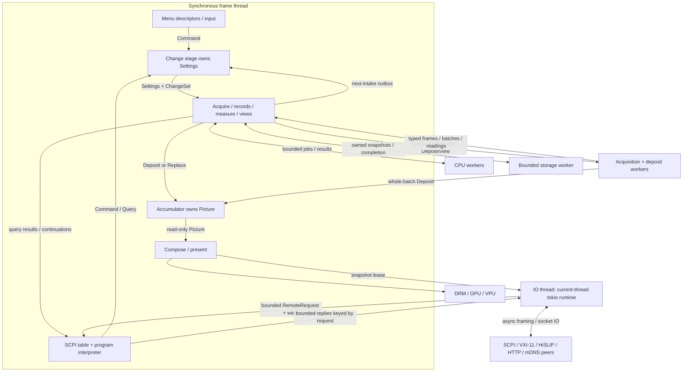

# UI architecture: current state and target

Source snapshot: 2026-11-17. The Current state section describes this checkout, including the desktop removal,
shared `Worker`, field-table generation and DSP decoder moves. They are source evidence, not unit measurements.
[Migration](migration.md) lists the remaining work. [Acquisition](acquisition.md), [picture](picture.md)
and [records](records.md) describe the detailed target, not completed implementations.
The owner-approved [frame pipeline](frames.md) replaces worker-share maps and read-and-drop overload in that
target. F0-F7 are planned work; F4 is M12b and F7 supplies M16b picture state.
Sections from Layers onward describe the target unless explicitly marked as current source or measured evidence.

## Why

Keep the frame loop responsive while acquisition, remote clients and storage make progress.
Give settings, records, pictures and views explicit owners. Remove repeated dispatch and blocking IO.
Keep the existing behaviour through small migrations. The accepted decisions are
[ADR 0038](../adr/0038-menus-and-parser.md),
[ADR 0023](../adr/0023-io-layer.md) and
[ADR 0029](../adr/0029-table-generation.md).

## Current state

`oos-ui` uses `src/main.rs` for its binary and library module graph. `main` selects scripted execution,
host `--serve`, or Linux device execution in `system/device.rs`. The browser is the host desktop view.
There is no native Windows window in this crate. `oos-core` depends only on `oos-dsp`;
`oos-ui` depends on core, DSP, HAL, libc, tokio and mdns-sd. Raw SCPI, VXI-11, HiSLIP and HTTP/MCP share tokio on netio;
mdns-sd owns a discovery daemon behind a netio adapter.
DSP decoders now live under `dsp/src/decode/`; UI protocol modules supply their application bindings.

### Module map

| Current files under `ui/src/` | Responsibility |
|---|---|
| `system/device.rs`, `system/device/` | input/remote intake, nominal 30 Hz frame scheduling, graphics, timers, shutdown |
| `ui.rs`, `ui/` | model, records, maps, measurements, views, menus, input actions and service status |
| `model.rs`, `model/` | core model exports, platform/capability bridge, protocol bindings and colours |
| `scpi.rs`, `scpi/`, `cmd.rs` | shared SCPI interpreter and program continuations; script/FIFO command syntax |
| `http.rs`, `http/`, `vxi11.rs`, `hislip.rs`, `mdns.rs` | web/MCP, instrument transports and discovery |
| `netio/`, `netport.rs`, `netport/` | raw SCPI/VXI-11/HiSLIP/HTTP/mDNS runtime, socket framing/output and owned bounded application ports |
| `remote.rs` | firewall and SSH ACL helper |
| `store.rs`, `store/`, `sysconf.rs` | setup codec, waveform/image files, durable startup state, system settings |
| `board/`, `board/dho/` | Board port, Shared exchange, hardware configuration/readout and publication |
| `picture/` | captured drawing inputs, placement pool, owned column differences and UI accept/fold (F2) |
| `wave.rs`, `drawpipe.rs`, `drawpipe/`, `fastdraw.rs`, `sparse.rs`, `compress.rs` | records, phosphor maps, batch deposits and drawing kernels |
| `gfx.rs`, `font.rs`, `layout.rs`, `drm.rs`, `gpu.rs`, `vpu.rs` | software drawing, layout, scan-out, GPU helper and JPEG encoder |
| `ui/lifecycle.rs`, `ui/lifecycle/` | lifecycle polls, watchdog, measurement worker and generic job worker |
| `ui/wlan.rs`, `ui/time.rs`, `sntp.rs`, `ui/bode.rs`, `usbtmc.rs` | WLAN, clock synchronization and external generator IO |

Largest source files, physical lines including tests, comments and blanks (`wc -l`):

| File | Lines | File | Lines |
|---|---:|---|---:|
| `ui/src/ui.rs` | 15,856 | `ui/src/scpi.rs` | 7,233 |
| `ui/src/store.rs` | 4,551 | `ui/src/board/dho/hw.rs` | 3,938 |
| `ui/src/ui/lint.rs` | 3,337 | `ui/src/ui/eyepage.rs` | 2,876 |
| `ui/src/http.rs` | 2,445 | `ui/src/ui/analysis.rs` | 2,181 |

These are not production LOC. The size ratchet counts 375 code lines in `Ui::step`,
1,467 in `Scpi::exec_cmd`, 652 in `store::set` and 860 in `hw::spawn`.
`Ui` has 215 fields. `core/src/model/state.rs` declares 296 public `Model` fields.

### Settings, commands and menus today

`Ui.m` is the flat core `Model`. Menus, keys, SCPI and `store::set` still mutate it directly.
`core/src/change/` supplies normalization, classification, mapping keys, identities and bounded outboxes.
`field_table.rs` generates flat-field comparison/refresh and typed patches from one field inventory
(ADR 0029); member-level classes and mapping logic remain separate. This is not yet grouped settings ownership.
`Command` is a transitional API with Run, Timebase, Channel, TriggerMode, AutoFast, Request and Patch variants.

`ui/change/` accepts changes, runs reset consumers and publishes acquisition settings.
Autoset, Bode and completion STOP proposals wait in an outbox until intake.
The old reset observer is retired in production; historical comparison code remains in tests.
SCPI queries and program ends also accept changes, so queries observe earlier setters without waiting for a frame.

`Item` has 457 variants; `MenuId` has 48. Six dispatch chains in `ui.rs` describe an item:
`kind`, `label`, `value`, `options`, `adjust` and `activate`. Area helpers repeat those entry points.
`menu_items` builds ordered rows with visibility conditions. `active_choice/` supplies committed option indices;
focus, picker state and menu history remain on `Ui`. The descriptor model and overview are not implemented.

### Frame loop and data flow today

On the device, `Device::intake` polls panel/touch/FIFO then remote services.
`Device::frame` runs `Ui::step`, rendering and presentation when the frame interval has elapsed.
HDMI CPU output runs every other panel frame. Persistence observation and network timers follow presentation.
Host `serve` has its own step/render/transport loop; scripts use the same `Ui` with a headless `Host`.

`Ui::step` polls lifecycle services, accepts normalized changes, then handles records and drawing.
It drains queued frames on the fast route or builds records on the frame loop.
It accepts whole deposits, updates history/mask/segments, measurements and analysers, queues internal proposals,
updates panes, and grades/halves the maps. Rendering is a separate call.
`ph` and `phz` are still public `Ui` fields with several writers.

Raw SCPI, VXI-11, HiSLIP and HTTP TCP/UDP framing and writes share one current-thread tokio runtime on the `netio` thread.
mDNS uses mdns-sd's daemon thread for packets, probing, conflict handling and two-second interface refresh.
Its netio adapter passes owned service configuration and receives status events. Switching off withdraws
registrations and closes the daemon sockets, leaving the shared executor available to other services.
LAN access checks and the subnet picker share safe IPv4 interface enumeration in `oos_hal::system`.
IO owns credits until output completes and enforces 2 s without progress and 30 s total send limits.
VXI-11 links and HiSLIP sessions retain frame-owned resumable programs behind owned request/reply ports.
HiSLIP shares the eight-connection limit, admission, cancellation and timed output machinery. Its reply budget
covers eight existing response assemblers, each with up to twice the 64 MiB response ceiling for geometric
allocation growth plus framing metadata; output sends borrowed payload slices without assembling a second copy.
VXI-11 preserves eight TCP connections plus a separate 1500-byte UDP portmapper request, sixteen links,
and the existing per-link pending-program/output bounds. Its RPC output port reserves up to two RESP_MAX
payloads plus 4096 bytes for framing, because a link can append a program before its next output-limit check.
This preserves reads larger than one program; it does not change the raw SCPI 64 MiB reply budget.
HTTP retains eight pending readers, one large-body admission, eight screenshot waiters and two large outputs.
Static pages stay on IO; owned requests and socket-free reply handles cross bounded intake. Application responses use
shared timed output and reservations. Live-picture encoding stays on its CPU worker. Signed upload bytes remain
on a separate worker; only its bounded header and job handle cross frame intake before verification is started.
MCP uses the same interpreter. The FIFO enters through `cmd`.
mDNS configuration uses a watch channel; mdns-sd owns its sockets and timers.

`Worker<J, R>` shares bounded capacity-one job/result channels and nonblocking submit/poll across
simulation, reference analysis/decode/search, math, bus, eye and measurement-catalog jobs.
One job remains busy until its result is consumed. `MeasWorker` is separate; it handles live measurements
and analyser windows. WLAN and SNTP use their own job/report threads. Bode's external generator thread
owns blocking TCP or USBTMC IO. These are not users of a shared IO runtime.

`store.rs` combines setup serialization, string setters, waveform parsing/exports and image encoding.
Manual setup saves and automatic promotion share one storage worker using `store/durable.rs`.
Four outstanding requests, including unconsumed completions, each admit at most 64 KiB of setup text and
a 4 KiB path. Full manual queues fail immediately; automatic observations retain only the latest candidate,
with every edit restarting its stability interval. Shutdown drains accepted writes before marker cleanup.
Manual exports and screenshots still call synchronous file IO from UI actions.

The draw routes also remain distinct. Standard/Frames queues frames. Batch places records in a persistent pool
and hands whole deposits of owned column differences to the UI. The UI folds once per accepted deposit and sends
its newest waveform to record readers. Batch is the code and image default; `acq.pipeline = standard` or `frames` selects
Standard. `fast_ok` selects eligible hardware views. `drawpipe::draw_frame_reusing` uses dense `fastdraw` spans,
sparse interpolation or deep-record drawing. `Phosphor::draw_ex` handles record drawing.
CPU rendering and GPU layer composition both exist. `Model::draw_batch` selects the hardware route;
`draw.model` is absent from this checkout. The owner selected Batch with the shared difference kernel;
M12a unit acceptance still precedes deletion of Standard in F4 (M12b).

Boot images contain shared model defaults; device identity and overrides stay in `/oos/system.conf`. Updates compare
runtime hardware model detection with a signed model list and board target (ADR 0015). See [system](system.md).

## Layers

Everything below is the target. New paths are planned destinations, not today's module tree.
The domain, DSP, acquisition and frame loop remain synchronous. Adapters depend inward on typed ports.

| Layer / destination | Owns | Dependencies and seam |
|---|---|---|
| `core/model`, `core/change/settings` | private settings groups, invariants, pure values | DSP and std; capabilities/time supplied as values |
| `core/command`, `core/change` | grouped Command/Query, errors, normalize/classify, identities | domain values; accepts commands, publishes immutable state and ChangeSet |
| `ui/menus`, `ui/views` | descriptors, focus/navigation, per-view state | read-only settings/results; emit commands or navigation events |
| `ui/remote/scpi` | command table, program/error/OPC state | typed commands and queries; interpreter runs on frame thread |
| `ui/src/netio/` (top-level `netio`) | one current-thread tokio runtime, sockets and transport timers | bounded request/reply ports; no reference to Ui or mutable settings |
| `ui/app`, `ui/records`, `ui/picture` | Session wiring, records/jobs, accumulator | domain and ports; synchronous stages with explicit inputs/outputs |
| `ui/compose`, `ui/display` | layers, presentation and snapshot leases | read-only picture/views; DRM/GPU/VPU confined to display |
| `ui/board`, `ui/store`, `ui/system`, `ui/instruments` | hardware, durable files, services, external devices | typed requests/results; no adapter-to-adapter state access |

ADR 0023 keeps non-blocking IO behind ports, preferably on one current-thread tokio runtime.
The current Cargo features are rt, net, time, sync, macros and io-util. Raw SCPI, VXI-11, HiSLIP and HTTP/MCP
use the netio executor. mDNS uses its crate-owned daemon behind a netio adapter (ADR 0023).
NTP and the update check remain migration work. USB bulk and WLAN control also move behind
non-blocking ports where async removes blocking. Blocking filesystem, usbfs and process calls never run on
the executor; use bounded blocking adapters. CPU work stays on CPU workers.

## State and ownership

Target writers: change owns Settings; records owns history/results; accumulator owns maps/weights/window;
each view owns its state; menus owns navigation; IO owns connections; storage owns pending durable writes.
Session only wires stages and channels. It must not become a renamed `Ui`.

### Enforced by visibility

Put private settings below `change`; export `&Settings` and typed commands.
Keep picture fields private to the accumulator and expose `&Picture`.
Adapters receive owned requests, not `&mut Ui`. Add boundary rules only as code meets them.

## Settings and commands

M13 groups settings without changing values or setup compatibility. M14 replaces edge writes by commands,
including relative knob edits. Apply deferred internal commands before external intake; preserve SCPI program order.
The later store/remote/input merge order must be explicit and tested when those edges share command intake.
One descriptor inventory supplies menu metadata; one SCPI table supplies accepted headers and typed mappings.
Generate repeated field handling only under ADR 0029, with every row exercised by tests.

### Normalize

Use the existing pure normalizer and capability Config. Preserve repair order and idempotence.
A group move must produce the same normalized values and ChangeSet as the flat model.

## Change detection

The accepted ChangeSet drives resets and publication once. Do not restore broad dirty marks.
Preserve SCPI query/message-end change points as well as frame intake.

### Generations

Current `Identity` has `gen`, `epoch`, `stats_gen`. Frames carry `(cfg, stamp)` as `(gen, epoch)`;
frame intake checks that pair. Measurement/fold results also check statistics identity.
Autoset/Bode stage tokens resolve through the outbox. Keep these contracts during decomposition.

### Acquisition intent

Today `Board::want` takes `&Model`, and core `AcqIntent` borrows it.
M5a must provide an owned, board-neutral AcqRequest before grouped settings remove that dependency.
Typed requests, frame metadata and batch ownership follow [acquisition](acquisition.md).

## Step pipeline

Target order: intake, change, acquire, records, accumulate, measure, views, compose, present, reply (ADR 0034).
Internal proposals apply at the next intake. SCPI query barriers may accept a change between full pictures.
Extract stages around today's acceptance and publication seams before moving their state.

## Threads and messages

Frame thread never awaits or waits for client/disk completion. Top-level `netio` owns sockets and timers;
it never interprets settings or runs DSP. Its public port uses synchronous owned values, not tokio types.

- The request unit is a complete program message, not a semicolon-delimited command. Each connection has one
  credit from admission until the entire reply is sent (or a no-reply completion arrives). Stop reading/admitting
  its next message until credit returns; keep pipelined bytes within framing limits and preserve FIFO order.
  Envelopes carry connection incarnation and request id; disconnect cancels/releases them, never retargets replies.
- One frame-owned Scpi keeps shared `wav_src`, `wav_fmt`, error queue and ESR across connections. Preserve that
  shared behaviour; do not silently make it per-client. Execute admitted program messages in FIFO admission order
  without interleaving their commands, including continuations. `:WAV:SOUR;:WAV:DATA?` captures its own source
  and format before another program can mutate them. Waiting programs retain identity/snapshots, not socket borrows.
- Reserve reply capacity before interpretation; never rerun a setter to retry output. If the reply channel is full,
  park the owned reply and its reservation on the frame side, retry with try-send on later intake, and continue
  frames/input. Parked, queued and IO-held replies share the global byte budget below.
- Per intake, visit at most 8 requests/continuations; stop taking work after 0.5 ms, checked between interpreter
  turns. A turn is not preempted. Preserve program ownership when yielding; rotate eligible connections in FIFO
  admission order. Quota/ordering tests inject time; large-message/indivisible-command cost and due-frame latency
  are checked by perf/unit evidence before rollout.
- IO timers enforce the existing 2 s without send progress and 30 s total send limits; timeout closes the
  connection and releases credit, reply bytes and snapshots. No frame-thread blocking write or timeout remains.

RemoteRequest also covers non-SCPI application operations: UiState, ImportWaveform (slot/name plus bounded owned
payload handle), ExportWaveform (CSV/binary), ExportLogicCsv, Stamp, UpdateStatus and Cmd (ordered command list
plus local/HTTP origin). These map `/ui-state`, `/waveform`, `/wave.csv`, `/wave.bin`, `/la.csv`, `/stamp`,
GET `/update` and `/cmd` to frame-owned handlers. HTTP Cmd preserves `cmd::remote_ok`; FIFO Cmd retains local
syntax/privileges. Neither path is passed through the SCPI parser. A request sees one coherent frame-owned state;
CPU encoding uses an owned bounded snapshot off main. Static HTTP content stays in IO; screenshots use leases.
POST `/update` is a separate bounded large-body upload/verification worker path for signed packages, not a program
message or an ordinary request-body copy. Only its owned job handle, progress and result cross the frame seam;
preserve existing upload limits, single-large-body admission and signed-update lifecycle.

Each channel needs entry/payload bounds, overload behaviour and shutdown ownership. CPU jobs retain bounded
submit/poll. Storage accepts owned snapshots and returns completion/errors for toast/status.

### Waiting

M15a-0 adds an eventfd to the frame loop's input pollfd set before the runtime experiment. Today libc::poll
can wait up to 33 ms and remote is polled once per pass. Enqueue then signal; drain/recheck without lost wakes,
including when a quota leaves queued work. IO reply-capacity/cancellation notifications also wake intake.
Keep light intake separate from paced rendering; remote requests do not force a render.
Acquisition/DMA waiting remains separate; tokio does not move into HAL or DSP.

### Placement

Placement policy lives in `placement` (`perf.place`). Board-independent core discovery and safe OS calls
(affinity, idle priority, filesystem statistics and realtime clock setting) live in `oos_hal::system`,
with cores read from `cpu_capacity`.

## Memory and queues

The requirements below are the target contract for M5/M5b and later consumers, not implemented bounds or a
measured RSS ceiling. Current outboxes cap entries at 64 and retained bytes below 64 KiB; core snapshots also
reject oversized capacity. Current watchdog defaults are 768 MiB soft and 1024 MiB hard (`system/memory.rs`).
Every target buffer and queue is bounded in bytes as well as count; the watchdog does not replace those bounds.

### Memory plan

`oos_core::memplan(&Settings, &Caps) -> MemPlan` accounts for acquisition buffers and remote reservations:

| Class | Holds | Size |
|---|---|---|
| `dma` | the read-out buffers of the batch pool | (in-flight batches + a fixed pin allowance of 1) x batch bytes; in flight is at most the pool of 3 |
| `raw` | raw re-reads (deep window, `RAW_PERIOD`, STOP final) and the holders' copies of kept frame ranges (`last[0]`, measure jobs, remote snapshots, export) | one window per channel for rereads, plus each holder's limit in [Retaining owners](#retaining-owners) |
| `ring` | the roll and scan ring, immutable chunks (`Arc<[Chunk]>`) | one screen: 10 x tdiv / dt points per channel, x 4 B (`f32`), plus the chunks a reader still pins |
| `segments` | read-back segments in flight | the segment channel's bound |
| remote replies | assembled, parked, queued, IO-held responses and encoding chunks | 64 MiB global allocated capacity; <= RESP_MAX per program |

Current `RESP_MAX` is 64 MiB and `MAX_CLIENTS` is 8: per-client caps alone allow 512 MiB of replies,
before acquisition/maps, against a 768 MiB soft watchdog. M15a reserves from one 64 MiB global reply budget
before execution (conservatively RESP_MAX when the reply size is unknown); lack of credit delays admission, not
an already-applied setter. Transfer the reservation with replies/chunks; never duplicate unaccounted capacity.
Reply bytes are a separate class of the memory plan, not eight independent per-client allowances.
The admission plan includes request buffers (raw MAX_LINE is 4 MiB), snapshot copies, encoder scratch and the
separate large upload/import bounds. Base + maps + acquisition + retained data + these remote bounds + explicit
headroom must fit below the 768 MiB soft limit, counting retained replies once. M5b sweeps that total;
M15a supplies measured fixed costs and rejects admission that cannot fit. The watchdog stays unchanged.

M15a's raw port retains at most 32 MiB of framing buffers, 32 MiB of queued program text and
4 MiB plus bounded command metadata for the active parsed program. One 64 MiB reservation covers all
raw replies and overlapping encoder allocations; chunk capacities and their container are charged once.
Waveform encoding borrows frame-owned samples, so it adds no waveform snapshot copy or retained record.
Allow 16 MiB for metadata, malformed-text conversion, stacks and runtime overhead: the raw planning
allowance is 148 MiB. Existing HTTP large-body admission is separate: one 128 MiB import or 70 MiB signed
upload, plus eight 1 MiB small bodies and bounded headers. These are source bounds and planning allowances,
not measured RSS. An illustrative planning envelope (not new acquisition limits) of 120 MiB base/maps,
256 MiB acquisition, 64 MiB retained data,
148 MiB raw, 136 MiB HTTP and 32 MiB headroom totals 756 MiB, below the unchanged 768 MiB soft limit.
The unit gate must validate the fixed-cost allowance and acquisition/retained envelope before rollout;
M5b still owns the complete acquisition memory sweep. Host tests prove the raw queue and response bounds.

The other buffers do not depend on the acquisition and are bounded by their own constants, each next to its owner:
the difference planes (open, slot and three window deposits, main and optional zoom), the accumulator Picture, the
record store (`HISTORY_MAX` x screen record), and each view's maps (`EYE_MAX`, `SPECTRUM_MAX`). The memory budget
in [Performance budgets](#performance-budgets) is `memplan`'s total plus these constants. The target picture window
holds at most three whole deposits and 67 ms of age ([picture requirement](picture.md#window-and-grade)).

- Ring snapshot protocol: the writer appends chunks and never changes a published one. A sweep is a list of chunk
  `Arc`s. Only in-flight work (the records stage, a measure job's copy step) pins a sweep's chunks, for at most one
  step; a holder that keeps the sweep longer copies it once, off main, into its own bounded buffer. The `ring` class
  is one screen plus one pinned sweep, 2 screens at most. A chunk is freed when the writer has passed it and no
  reader pins it.
- The acquisition thread and the pipe allocate from the plan, not from their own estimates.
- A host test sweeps `memplan` over mode x channels x depth x time base on every model's `Caps`. If no reachable
  setting exceeds `Config.mem_budget`, the test asserts that, and there is no depth clamp. If one does, `normalize`
  clamps the depth (Auto included) so that the total stays within the budget, and the test covers the clamp. The
  sweep, not a guess, decides whether the clamp exists.

### Budget arithmetic

Memory available to `oos-ui`: the RK3399 has 3.9 GB of RAM, and about 3.6 GB is available after boot (measured
2026-11-14, `MemAvailable`). The Zynq-side DDR belongs to the FPGA and is not visible to Linux; it is not part of any
budget. There is no swap.

Peak use is the sum of four terms. Each factor is a named constant or a `Caps` value, and the `memplan` sweep computes
the sum for every reachable setting:

| Term | Formula | Factors |
|---|---|---|
| base | process, fonts, layout, GPU arena | measured: 73 MB RSS with 4 channels in RUN on the panel (2026-11-14) |
| maps | five difference-plane sets total, including hand-off and recycling, plus Placed arena and Picture; main plus zoom if enabled | difference set = channels x cols x (rows + 1) x 2 B; Picture counts use 2 B at Min, 4 B with decay; [frame memory estimates](frames.md#memory-estimates) |
| acquisition | `dma` + `raw` + `ring` + `segments` + decoded copies | `dma` = pool (3) x batch bytes; decoded = 2 x code bytes (u16 codes to f32 volts) for every frame decoded at once; `raw` <= `deepmeas::MAX_BYTES` (24 MiB) per window |
| retained | every retaining owner below at its limit | [Retaining owners](#retaining-owners) |

The maps peak is one open set, one occupied slot and three window deposits. Before accepting a fourth window
deposit, the UI recycles an old entry, then moves the accepted deposit out of the slot into the window. Refilling
the slot moves the existing open set and reuses the recycled set; no sixth set is allocated during hand-off.
The [frame memory contract](frames.md#memory-estimates) defines ownership and waiting when no recycled set is free.

- **Buffer return.** A DMA buffer goes back to the pool only when its last reader drops it: the workers have
  deposited, the records stage has built its records, and every holder has made its copy. An `Arc` pins the whole
  allocation, not one frame, so the in-flight readers are kept to one step ([One ownership path per
  batch](#one-ownership-path-per-batch)). Acquisition reserves a free buffer before arming, including prearm.
  With none free it waits in the command event wait, counts wait time and reports capture dead time (F3).
  It never overwrites a held buffer or reads a batch merely to drop it under load.
- **Reconfiguration overlap.** The acquisition thread allocates the new plan's buffers when the old plan's are back,
  while nothing is armed. Old buffers still in flight at the switch (at most the pool of 3, for at most one step) are
  counted in the `dma` class of both plans for that step; `memplan` adds the old pool to the new plan's total when it
  checks a reconfiguration against the budget.
- **The two figures.** The baseline in [Performance budgets](#performance-budgets) (120 MB) is the measured base plus
  the maps term at HDMI size. `Config.mem_budget` (default 512 MB) bounds the acquisition and retained terms. M5b
  replaces both with the values the sweep computes, and the sweep test fails if a later change moves them by more
  than 10 % without a doc change.
- **Rejection.** If even the smallest plan for a setting (minimum depth, fewest buffers) does not fit
  `Config.mem_budget`, `apply` rejects the command with a `CmdError`, and a setup file that holds it loads without
  that key. The depth clamp in `normalize` applies only when a smaller depth fits.

### Retaining owners

Every owner that keeps acquired data past its step has a byte limit and a release rule:

| Owner | Limit | Released when |
|---|---|---|
| `last[0]` and its raw copy | one record, one raw frame range in its own buffer (`raw` class) | the next record replaces it |
| running measure job | its own copy of one raw frame range per channel | the job ends |
| pending measure job | its own copy of one raw frame range per channel | a newer record replaces it, or a `stats_gen` or epoch change discards it |
| ring chunk pins | 1 sweep, in-flight work only, at most one step | the step ends; longer holders copy |
| history and segments | `HISTORY_MAX` screen records, no raw | the oldest entry drops out; the `history` class clears it |
| waveform snapshots held by remote listeners | its own copy, one per connection, 2 over all connections | the answer is sent, the connection closes, or the send times out |
| picture snapshot leases (readback buffers at the encoder) | 2 x one picture (2.46 MB on the panel, 8.3 MB on HDMI) | the encoder returns the buffer; after 1 s the next snapshot is refused |
| remote replies and output chunks | 64 MiB global capacity, counted once through every owner | send/completion, disconnect or IO timeout |
| remote connections | 8 over SCPI, VXI-11, HTTP and MCP together | a ninth is refused at accept |
| `RemoteRequest` | 1 in flight per connection, 8 globally; payloads bounded by route and total admission plan | reply sent or no-reply completion; disconnect cancels |
| export (CSV, PNG, setup) | one at a time, from its own copy | the file is written |

- A slow waveform client uses the IO-side 2 s stall/30 s total send limits. Closing releases the snapshot;
  its owned copy never pins a DMA buffer.
- The sum of these limits is the retained term of the budget arithmetic.

### Queues

Every channel between threads is bounded in count and in bytes, and has a stated overload policy. The acquisition
thread may wait for buffer return at the source, interruptible by commands. The frame thread never waits for
pipeline capacity.

| Channel | Bound | When full |
|---|---|---|
| `Batch` into the pipe | the pool (count) and the `dma` class (bytes) | source waits for a buffer before arming; commands share the wait; count dead time, never overload loss |
| `Deposit` to main | one slot; five plane sets including open and up to three window entries | coalesce whole batches of one key/identity within per-plane column-hit bounds, then wait; the source eventually waits for buffer return |
| newest-record taps to main | [plan-derived FIFO, storage and drain bounds](frames.md#tap-capacity) | pool waits; never replace a batch's unread tap; main polls without waiting |
| `RecordBatch` to main | 2 per step, `records` class | workers wait for space, retaining whole batches; finite buffers propagate back-pressure to the source; no overload drops |
| `Frame` (live roll and scan sweeps; batch newest records use the tap FIFO) | latest-value cell: one sweep | replaced; a sweep is screen-resolution min/max plus the `Arc`s of its ring chunks, never a copy |
| segment read-back | 2 batches of segments, `segments` class | back-pressure: the read-back waits for space. Safe because acquisition is stopped during read-back |
| `MeasRead` | latest-value cell per kind | replaced by the newer read |
| `AcqCmd` | 16 | the sender gets an error; commands are never dropped silently; a superseded command is acknowledged as `Superseded` |
| `RemoteRequest` | credit 1 per connection, 8 globally; raw text <= 4 MiB each, other bodies use route limits and admission bytes | stop admission/reading until credit and bytes are available; HTTP may return 503 before admission; never silently drop an admitted program |
| remote replies | 64 MiB globally including parked replies and chunk capacity; <= RESP_MAX per program | reserve before execution; frame parks a completed reply on a full channel and retries nonblocking; IO sends chunks in order and closes on 2 s stall/30 s total timeout |
| `InputEvent` | 64 | knob steps coalesce (relative steps add up); keys are never dropped |
| measure jobs | one running, one pending | the pending job is replaced by a newer record |

### Degradation order

Under overload, measurement reads (`MeasRead`) and pending measurement jobs keep the newest value and count
replacements. `Deposit` and `RecordBatch` retain whole batches and wait on the worker side; finite buffers
propagate back-pressure to the source. Readers such as mask, zones and segments lose no read records to overload.
Source back-pressure reports reduced capture rate and dead time
([conservation](frames.md#back-pressure-and-conservation)).

The picture's newest batch and input handling are never shed.

### Watchdog

The protection is in this order. The watchdog is the last line, never the design:

1. **Bounded allocation.** `memplan` and the byte bounds above keep use within the budget in every reachable setting.
   A setting that cannot fit is rejected.
2. **STOP releases.** STOP (from the user or the watchdog) releases what is in flight: queued `Frame`s and
   `RecordBatch`es, the pending measure job, ring pins beyond the current sweep, and remote waveform snapshots that
   are not being sent. It keeps `last[0]` and the allocated pool, so RUN needs no allocation. At the watchdog's hard
   limit memory wins: its `reset()` drops `last[0]` too, and the stopped picture keeps only the maps.
3. **Watchdog.** `system/` reads the process RSS once a second. A once-a-second check cannot catch a fast runaway on
   its own; it catches a slow leak that the bounds missed. Above the soft limit (`Config.mem_budget` + 256 MB) it
   logs and shows a warning. Above the hard limit (1 GB) it forces STOP through the outbox without a `Final` command, so the
   watchdog's STOP never does the allocating final raw read, calls `reset()` on the stages that hold buffers (records,
   accumulator, views), and shows a toast. If RSS is still above the hard limit 5 s later, `oos-ui` exits with code
   75, and rcS starts safe at once. The limits are `Config` values, tuned on the unit.

### Observability

Each channel and each shed above has a drop counter. `:SYSTem:STATe?` prints them on one line,
`drops batch=N recbatch=N frame=N measread=N acqcmd=N remote=N input=N measjob=N frozen=N`, next to RSS, the `memplan` total
and the watchdog state. F0/F3 replace deposit-route overload drops with the
[frame counters](frames.md#counters). Live pending counts and drained identities follow the canonical
[conservation rule](frames.md#back-pressure-and-conservation), including separate RecordBatch accounting.
unitlab fails a run where a counter grows that must stay 0 in that mode.

## Data path cost

### One ownership path per batch

Target batches retain their own conversion metadata and ownership through workers and readers.
Long-lived history copies only its retained range. See [records](records.md).
Today Shared publishes Arc frames; that does not establish zero copies for every record consumer.

### Maps: column differences and whole deposits

The [frame pipeline](frames.md) supersedes worker pre-summing. The pool places records in slices and deposits
exclusively owned column bands into one plane set. Whole batches coalesce into Deposit values. The UI takes at
most one per step and folds up to three window deposits in one pass per channel over touched rows.
The accumulator owns weight/decay/grade. Current share merging has not reached this target.

## Safe start and exit

`store/startup`, `system/shutdown`, `ui/lifecycle` and worker shutdown implement startup quarantine,
durable markers, watchdog handling and ordered teardown. Preserve their existing tests and error propagation.
The safe-start task is [0048](../tasks/done/0048-m1b-safe-start.md).

### Kernel panics

Boot/watchdog/kexec contracts and hardware evidence remain in [system](system.md) and
[task 0054](../tasks/0054-kexec-dt-change-hang.md). Host tests do not prove a hardware recovery path.

## Performance budgets

GPU migration uses dirty regions, a fenced buffer pool, asynchronous on-demand snapshots and fused
accumulation/decay without maxima scans. Hot shared counters are per thread and cache-line aligned; readers sum
them. Each hand-off has a contention counter. A measured lock-free replacement lives in oos_hal::sync with its
own tests and Miri coverage. These are ADR 0031 targets, accepted through the performance migration steps.

Frame-pipeline stages use p50/p90/p99 over the last 256 observations, timed per slice, with the estimates in
[frames](frames.md#performance-estimates). Other target budgets retain the reporting interval below.
Every target budget must have a counter in `:SYSTem:STATe?` (p50 and p99 over the last 10 s, one line per thread)
and a gate ([ADR 0031](../adr/0031-performance.md)). Host perf guards check primitive ratios and
allocation counts; the absolute values must be asserted on the unit in each acceptance round. These are target
unit acceptance values, not achieved measurements. The values are for 4 channels on the panel unless a row says
otherwise; the first unit round after each step may tighten them, never loosen them without a doc change.

| Thread or stage | Budget | Counter | Asserted by | Guard lands in |
|---|---|---|---|---|
| main, full step (first A72) | p50 <= 8 ms, p99 <= 15 ms | `step` | unitlab | M3d (counter), asserted from round 1 |
| intake + change | p99 <= 0.5 ms | `stage intake`, `stage change` | unitlab timing (no host timing assertion) | M2.3 |
| picture invalidation (main and zoom map clear) | p99 <= 3 ms, provisional 4x host estimate plus tail headroom | `stage picture` | mandatory unit storm (no host timing assertion) | M2.3d |
| records stage | p99 <= 1.5 ms off the fast path; records are built on the workers | `stage records` | host timing guard, unitlab | M6 |
| picture blend (Min: up to three deposits; decay: one new deposit; one touched-row pass) | estimated <= 3 ms at Min, <= 4 ms with decay | `picture.blend` | host ratio guard, unitlab | F2, F6 |
| compose + present submission (sum) | p99 <= 4 ms; <= 6 ms on HDMI | `stage compose`, `stage present` | unitlab | M3d (counter), asserted from M9b |
| light step (input or remote) | settings round trip p99 <= 2 ms when main is idle | `light` | host test, unitlab | M3d |
| remote arrival to reply during full steps | p99 <= 3 ms, measured from the listener's read timestamp to the reply in the output queue | `remote latency` | unitlab (`ifload.py` with pictures running) | M3d |
| remote throughput | >= 500 query/answer exchanges per s on one SCPI connection, picture rate within 10 % | `remote` | unitlab (`ifload.py`) | M3d |
| acquisition notification | under 1 ms outside a C2H read (provisional until Platform tuning) | `acq wake` | host test with the scripted `Device`, unitlab | M3c |
| acquisition read chunk | p99 <= 20 ms per 4 MiB chunk; this bounds application and cancellation inside a read | `acq chunk` | unitlab | M3c |
| acquisition overhead per batch (excluding DMA and rereads) | p99 <= 1 ms | `acq batch` | unitlab | M3c |
| DMA completion | completion CPU <= 5 % of one A53; overhead <= 1 ms per 4 MiB beyond link time. Exception: a kexec session runs in poll mode, which burns an A53 per transfer, and is exempt; it normally ends with a warm reboot after the install | `xdma` | unitlab | M5c |
| place + deposit | estimated <= 0.25 ms CPU/record at 1 us/div, <= 0.5 ms at 10 us/div; pool <= 70 % per A53 | `deposit.place`, `deposit.tiles`, `pool.busy` | perf guard (ratio), unitlab | F2 |
| measure job | cheap set p99 <= 2 ms; full set on 4 x 625 k p99 <= 40 ms; deep work per [Depth baselines](#depth-baselines) | `measure` | perf guard, unitlab | M6 |
| GPU helper | CPU per composition <= 3 ms on the panel, <= 5 ms on HDMI; GPU time <= 10 ms | `gpu cpu`, `gpu time` | `gpu/test-host.sh` ratio, unitlab | M9b |
| HDMI | >= 29.5 pictures/s alone; >= 15 with the panel, counted when halved | `hdmi` | unitlab | M9b |
| picture rate | >= 29.5 pictures/s in every acceptance mode | `fps` | unitlab | exists |
| input to photon | the preview at the next flip; the first batch under the new mapping <= 70 ms | `latency` | unitlab | M4 |
| wake latency | main/input/remote/GPU < 1 ms; deposit/measure < 50 us; picture at next flip; provisional until [Platform tuning](system.md#platform-tuning) | `wake <thread>` | unitlab | M3c, M3d |
| idle in STOP | total CPU < 3 % of one A53; main wakes only on flips and input | `cpu`, `wakes` | unitlab | M3d |
| allocations | 0 per frame after warm-up on every hot path | `alloc` | counting-allocator tests | each step that touches a hot path; harness in G2 |
| memory | RSS <= 120 MB + `memplan` total, flat over a 2 h soak ([Memory and queues](#memory-and-queues)) | `rss` | host soak, unitlab | M5b |

Picture invalidation is a separate consumer phase; intake/change timing excludes it.
The IO experiment records its own before/after evidence. Existing host ratio guards below remain unchanged.
Absolute timing belongs in perf/unit acceptance, not machine-speed-dependent unit tests.
Host intake/change guards use the limits in `ui/src/ui/tests/allocation_budget.rs` and count the calling thread's
allocations after warm-up: input/change oracle cases and mapping acceptance with both map clears permit at most four
(five for CLEAR); Peak backlog intake permits six.
These bounds pin the existing complete change-point costs, including lifecycle polls and acceptance.
The existing counting allocator includes transient allocations and reallocations; worker and harness allocations
are excluded. The absolute intake/change and picture timing budgets remain unit acceptance requirements.

### Host budget rows

`tools/perf-budgets.py` reads this table. Candidate/reference paths alternate over 101 rounds.
Best ratios use elapsed time; p99 ratios compare process-CPU run distributions, including worker CPU.
They are not runtime frame-event quantiles or proof of unit performance.

| Guard ID | Best ratio <= | p99 CPU ratio <= | Workload / reference | Budget covered |
|---|---|---|---|---|
| batch_read | 1.0 | 1.5 | five approximately 4 MB batches; retained DMA buffer / allocating read | acquisition read primitive |
| batch_decode | 0.5 | 0.75 | five channel/depth cases; fused decode / two-pass decode | acquisition decode primitive |
| decode_f32 | 0.8 | 1.2 | same batches; f32 / f64 fused decode | acquisition decode primitive |
| perf_guard_batch_core_learning | 1.0 | 1.5 | full 4 MB, 1/2/4 channels; BatchMatch::learn / Standard deinterleave, learn and correct | ordered ADC learning; projected A72 p99 CPU <= 9 ms/4 MB at 4x host CPU ([basis](../fork/perf-plan.md#host-measurements)), unverified |
| perf_guard_deposit_spans | 1.25 | 1.875 | nine signals, 100 k and 12.5 k points; spans / pixel writes | deposit kernel |
| perf_guard_dots | 1.25 | 1.875 | nine signals, 100 k points; runs / per-sample adds | deposit kernel |
| perf_guard_fast_interpolation | 1.1 | 1.65 | seven sparse timebase/channel cases; fast / exact | deposit kernel |
| perf_guard_compressed_frame | 0.5 | 0.75 | 100 k point square, k=15; compressed / raw decode and draw | deposit kernel |
| perf_guard_codes_per_frame | 0.9 | 1.35 | five channel/trigger cases; codes / decode and draw | deposit kernel |
| perf_guard_pipeline_counters | 1.02 | 1.515 | identical warmed Batch pipelines, counters on / off; 1/2/4 channels at 1 and 10 us/div, full production-plan batches | temporary F0 staging elapsed overhead <= 2 %; restore 1.01 at F3 cutover (ADR 0031); CPU tail unchanged |
| perf_guard_deposit_worker_per_frame | 1.5 | 2.25 | three depths, measurements off; one worker / frames mode | worker orchestration |
| perf_guard_deep_record_reuse | 0.8 | 1.0 | 4 channels, 10M depth (625k pairs each); actual hw_record + reused draw / hw_record + independent draw_frame conversion | main-view conversion and draw |
| perf_guard_framestats | 0.7 | 1.05 | 125 k points, cheap set; fused / reference statistics | measure primitive |

Allocation probes require at least 64 allocation-free warmed frames for deposit spans/dots/codes,
cheap measurements and both core-matching probes. HAL separately checks retained reads and decode.
These are primitive guards, not a zero-allocation claim for the whole UI.

The F0 counter row alone permits temporary staging headroom. Restore best elapsed <= 1.01 at F3 frame
cutover in both the executable assertion and this table, with updated contract fixtures and all six measured
rows before accepting that cutover. CPU p99 stays <= 1.515 throughout; do not derive a larger tail from 1.02.
Keep the actual picture count, consumed-record count and pixel/pacing equivalence assertions.
This row neither accepts hardware performance nor releases the existing M12/unit holds.

### How each budget is measured

Run `tools/perf-guard.sh` for the host observations and `tools/perf-budgets.py --log` to validate them.
Runtime timing rings report acceptance/change/picture work; acquisition/deep-read counters separate DMA,
conversion and measurement costs. Hardware acceptance must record model, build, workload and raw evidence.

### Depth baselines

The earlier deep-raw measurements ([deep-meas](../fork/deep-meas.md), 1 ms/div, 10 M, CH1: a window of 12.5 MB) are the
reference for deep work. They measured: DMA 52 ms, decode 51 ms, screen record 5.5 ms, cheap measurement 58 ms. The
budgets above are for normal depths (up to 1 M points per channel on screen); deep work has its own targets:

| Work | Normal depth | Deep raw window (12.5 MB) | Basis |
|---|---|---|---|
| decode | none: codes stay codes | none for drawing; the measure thread converts only what a non-cheap measurement needs | ADR 0031, codes until volts |
| screen record | inside the records stage budget | <= 5.5 ms, off main | measured |
| cheap measurement set | p99 <= 2 ms | p99 <= 10 ms: one pass over 12.5 MB of codes at >= 2 GB/s, plus margin | from the 58 ms baseline, which included the decode to `f32` |
| full measurement set | p99 <= 40 ms on 4 x 625 k | measured in M6, recorded here | no baseline yet |
| reread DMA | not used | 52 ms per window, at most once per `RAW_PERIOD`, outside `acq batch` | measured |

Every guard of a shipping budget lands by M12, so the stable stop point ships with its budgets enforced.

Gate step G2 ([migration](migration.md)) adds the tools these guards need: tail-aware perf guards (p99 over repeated
runs against a reference, not only the best of rounds), the counting-allocator harness, and the unitlab budget table
read from this section.

## Testing

Docs and source contracts are host-verifiable. Refactors preserve setup round trips, SCPI sessions,
menu navigation, command ordering, identities and golden pictures in debug and release.
Use injected time and completion events. Measure scheduling and performance in the perf harness.
M12 unit acceptance is still open; see [migration](migration.md).

## Enforcement

Cargo enforces crate dependencies. `xtask/data/architecture.txt` confines HAL access to `board/dho`
and sets core module layers. Broad target UI layers are not yet installed. M15a confines tokio to `netio`.
M15a puts IO in top-level `ui/src/netio/` and adds `confine ui tokio -> netio` plus a `layer ui netio`
allowlist for `netport` owned values, the socket-free `mdns` responder and existing `net6`/`netacl` helpers,
excluding `ui`, settings and interpreter modules. The checker works on
top-level modules; nesting IO under `remote` would not enforce this separation. Frame-side code receives a
synchronous port; only netio constructs/polls the runtime. Current `remote.rs` remains the firewall and SSH ACL helper. IPv6 ACL prefix-file reads use a single bounded
blocking worker; they do not run on the IO executor. `std::net` is confined to netio and the explicit synchronous
exceptions in ADR 0023 (SNTP, the Bode generator worker and GPU Unix-socket shutdown). Pure address values use `core::net`.
The gate is `cargo xtask check`; fast is a partial gate. Size/lint debt only shrinks.
Authors run `cargo xtask ratchet` (`--move` for planned moves) under
[ADR 0006](../adr/0006-format-lints-and-ratchets.md).
Contributions and source provenance follow
[ADR 0003](../adr/0003-contributions.md).
See [development](../development.md) for executable checks and their limits.

### Epoch token protocol

This is the change-detection protocol for ADR 0033. Autoset and Bode run after change, so they request an epoch
by token instead of borrowing the change stage mutably. The next ChangeSet carries (token, epoch); a stage with
an unresolved token accepts no records. Tokens are unique per request; several requests can share an epoch.
Apply settings emitted with a token before resolving its epoch, so AcqIntent carries the new gen and epoch together.
An epoch-only change drops armed-ahead batches and queued older-epoch frames. SINGLE arm, CLEAR and RUN after STOP
resolve in the change stage itself. UiAcq is derived and diffed each step rather than stored. AcqIntent carries
the route into BatchMeta; DepositView carries the mapping and its acquisition pair in one snapshot. The pool checks
that pair before painting ([projection identity](frames.md#projection-identity)). In STOP a mapping change redraws
the last record.
Tests must cover unresolved tokens, same-step settings/epoch association and epoch-only acquisition boundaries.

### Error recovery mechanics

For the M16 stage target, each state-holding stage exposes reset and a fake-backed test that reset restores
new-stage behaviour. Detectable inconsistencies use debug assertions in tests/debug builds and one log plus
recovery in release builds, rather than an expect. Log format is `oos-ui <area>: <what> <values>`; review checks it.
These mechanisms implement ADR 0030 without requiring an error enum per small source file.
