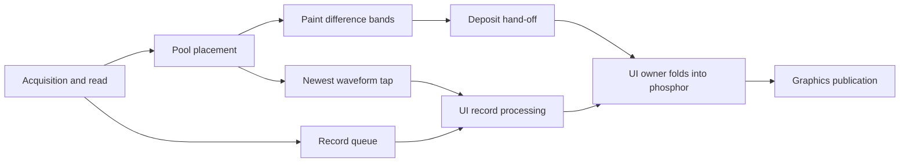

# Frame pipeline

The current pipeline uses Batch, holds the source in STOP and paces pictures from vblank.
[F0-F7](migration.md#f0-f7-frame-pipeline) describe the target approved in #196. Hardware
acceptance remains open.

## Existing evidence

**Implemented.** Host tests exercise picture equality, tap and deposit ownership, and record accounting.
The deposit route uses worker-owned column bands in one plane set. The UI folds the finished planes.
Batch is the sole hardware pipeline. Reads ineligible for deposits use the bounded decoded-record hand-off
for placement on the UI step.
Rates and timing from older builds describe those builds only. See [M12 acceptance](#m12-acceptance).

## Vocabulary and types

**Partly implemented.** A record is one acquisition of all enabled channels. A batch is a read of one
or more records. A picture is the phosphor state for a refresh.

| Design name | Code at this snapshot |
|---|---|
| `CapturePlan` | No type with this name. Capture planning uses HAL `Settings`, `hz::Params` and source-side state such as `ArmPlan`. |
| `Batch`, `BatchMeta`, `RecordRef` | `drawpipe::Batch` owns the read lease and carries a `feed::Header`, a decoder and an optional code adapter. There are no `BatchMeta` or `RecordRef` types. |
| `SamplesRef`, `Projection`, `Placed` | The [kernel](../../ui/src/picture/deposit/kernel.rs) implements these types. Some adapters operate on decoded screen records. |
| `DiffPlane`, `DiffBand`, `PerMap`, `Deposit` | Implemented. A plane can use narrow or wide counts. A deposit can own main and zoom maps and carry tap IDs and stage clocks. |
| `Waveform`, `RecordBatch` | The owned waveform hand-off uses a tap containing `Arc<board::Frame>`. Record delivery uses the board queue of frames. There are no pipeline types named `Waveform` or `RecordBatch`. |
| `Reducer`, `Accumulator`, `Picture` | There are no `Reducer` or `Accumulator` types. The UI's `Owner`, `DepositWindow` and `Phosphor` implement intake, folding and visible counts. The owner module's internal `Picture` is a view and identity snapshot for validation. |

The target keeps one decoded waveform form for readers and provides borrowed record views for workers.
The owned waveform cannot retain a batch or DMA lease. Retaining readers need their own budget.
The tap contract lets readers consume the newest waveform of each batch independently of deposit
coalescing and checks tap identity before using it.
`wave::Record` remains the view-window record for measurements, decoders, history and SCPI.

The deposit does not own a DMA lease. Tap storage owns samples separately from that lease.
The worker drops its batch reference before a blocking publication wait on the admitted path.
See [publication](../../ui/src/drawpipe/stage/owner.rs) and [records](records.md).

### Projection identity

**Partly implemented.** `core::change::DepositView` exists. The worker selects a frozen UI `View` by
checking the batch's acquisition generation and epoch before placement. The worker caches projections
for that view and the armed sample spacing. Conversion uses the batch decoder and layout.

A deposit's first use requires the current mapping and dimensions and the same acquisition generation
and epoch. Already retained deposits use mapping and epoch checks. Statistics have a separate
statistics generation. A current-acquisition tap can be drawn through a new mapping when its old
deposit is unusable, subject to tap eligibility. See [intake](../../ui/src/drawpipe/stage/intake.rs) and
[compose](../../ui/src/drawpipe/stage/owner/compose.rs).

### Invariants and units

**Partly implemented.** The deposit tracks record counts separately from sample-hit bounds and grading weight.
Times in placement are seconds and sample positions are fractional sample indices. Difference bands have
one writer at a time. Draw and analysis stages still use model snapshots. The target's single picture-writing
accumulator and universal W-only grading are unfinished. Some grading paths still scan for a maximum;
see [grade_refs](../../ui/src/ui.rs).

The F6 target uses W = 1 per line record and W = samples per column for dots, with separate sums for
main and zoom. Clipping does not reduce W. The target moves the fixed increment of 24 into grade.
These rules describe the planned normalization for every source, including replacement.

### Difference-plane capacity

**Partly implemented.** A span writes a positive difference at the first row and a negative difference
below its last row. A prefix sum reconstructs its counts. Dots can add multiple hits at one pixel.
Both count formats use an increment of 24. Narrow capacity is `floor(65,535 / 24)` hits.
Wide capacity is `floor(u32::MAX / 8 / 24)` hits, reserving headroom for persistence and channel sums.

Preflight can request wide storage. It closes an open deposit on a format change or when its hit bound
would be exceeded. A batch that exceeds the selected format's bound is accounted as `lost.budget`.
The window checks geometry, count format and the sum of retained hit bounds before keeping older deposits.
See [preflight](../../ui/src/drawpipe/stage/preparation.rs), [count formats](../../ui/src/picture/deposit/count.rs)
and [window retention](../../ui/src/picture.rs).

## Stages

**Partly implemented.** Hardware acquisition, pool placement, band painting, UI composition and
graphics publication exist. The source still decodes the newest frame in some paths. Record placement,
STOP, replay and record-based views also remain in the UI.

### Route and envelope

**Partly implemented.** The [route selector](../../ui/src/drawpipe/route.rs) chooses an adapter from
the frozen projection and frame metadata. Eligibility for the deposit pipeline is evaluated separately.
The ten labels in [`route.v1`](frame-counters.md#routev1) are:

| Label | Placement |
|---|---|
| `dense` | Dense line placement from eligible interleaved codes. |
| `peak` | Peak placement on the captured time axis. |
| `volts` | Decoded line placement. |
| `pairs` | Min/max pairs from compression or deep reads. |
| `dots` | Per-point placement. A decoded-dot path also exists. |
| `upsampled` | Sparse placement. Code interpolation and screen-grid fallback both exist. |
| `record` | UI record placement and the selector's roll or scan route. |
| `boxcar` | HiRes window placement, with screen-grid handling for dots. |
| `screen` | The screen grid for a raw deep-measurement window. |
| `zoom` | Zoom placement, with a main and a detail plan for the same capture. |

The dense envelope shares column edges across lanes. Code layouts support strides of one, two and
four words. Three channels use four lanes with one inactive lane. Correction applies the captured
eight-phase offsets before column reduction. AArch64 has NEON paths and scalar edges and tails.
Line spans can include the preceding column's last sample. Workers reuse placement scratch.
For paired codes, both words of pair `j` share the time of word `2j + 1` relative to the
record's trigger. A pair centre on a column edge belongs to the column on its right.
Line joins extend to the nearest end of the preceding pair if the two ranges are disjoint.
In line views with fewer than one pair per column, empty columns between pair centres cover the nearest
ends of disjoint ranges or the overlap of intersecting ranges. Each occupied column keeps its pair extrema.
Screen-grid adapters and decoded fallbacks remain. `ui/src/picture/deposit/standard` contains the
adapter implementations.

### Threads

**Partly implemented.** The acquisition thread owns the device and buffer pool. The coordinator sends
placement and band jobs to its worker pool. Placement slices hold at most 64 records. Band jobs take
exclusive ownership and return the touched bands. The UI thread owns the visible main and zoom phosphor
maps. Placement of these threads depends on startup settings and platform topology.

The asynchronous owner runs for eligible live Batch views at minimum persistence when a wake is
installed. It can take a completed deposit during intake and once more at compose seal if the queue
has space. The queue holds up to five inputs subject to backing capacity.
With synchronous intake, the owner takes the slot during compose and holds it through recycling.
`Owner::compose` validates deposits, merges compatible fresh planes for the minimum-persistence
window, then calls `DepositWindow::rebuild_picture` to fold into the phosphor. It can fold additional
fresh inputs directly using wide counts. With the window disabled, it blends each accepted input
directly. Folding runs on the UI thread in both cases. See [owner intake](../../ui/src/drawpipe/stage/owner.rs)
and [owner composition](../../ui/src/drawpipe/stage/owner/compose.rs).

### Variants compose

**Partly implemented.** Continuous hardware Normal, Peak and HiRes can use deposits. Edge triggers
can use the zoom route. Other eligible hardware triggers use the captured trigger position with zoom
off. Shifted enabled channels in newly eligible mode and trigger combinations can require the record
route. Single, segments, Bus, Video All Fields, software mask or zones, XY, Z input, roll and scan stay
on record or stream paths. Software Average on a plain sample grid folds contiguous record ranges in
the batch pool and sends one screen average with the newest raw waveform tap. The fold uses the same
DMA samples as placement. Both software routes seed a fresh average when the time grid, trigger
alignment, record depth or enabled channels change. Vertical scale and offset changes preserve the
voltage seed. The records path still handles hardware Average and software Average on min/max pairs. See
[`Ui::fast_ok`](../../ui/src/ui.rs) and [hardware trigger selection](../../ui/src/drawpipe/route.rs).
Taps feed record consumers. Display overlays are composed separately from the deposit planes.

### Minimum persistence and GPU hand-off

**Partly implemented.** The window retains up to three deposit sets subject to geometry, format and hit bounds.
It adapts its record target to recent picture contributions. Idle steps reduce the target and can keep the
visible picture. Owner composition credits a record on its first acceptance. The current window has no
elapsed-age eviction. STOP, remapping and preview still use UI lifecycle and record paths.

The graphics publication path tracks changed rows and copies their covering hull. Distant changes can
force an upload of the unchanged gap, including a full-height upload in the limiting case.
The target `Picture::dirty` and a single accumulator-managed replacement and grading API are unfinished.
The current publication contract lives on `Phosphor` and the graphics path. See ADR 0031.
It includes rows cleared by invalidation or eviction. Map identity and graphics layout changes can
force a complete initial copy.

### Newest record in a picture

**Implemented for deposit placement and tap separation.** The last eligible record of a batch contributes to
its deposit through the selected placement plan, like the other eligible records. A picture can include
several batches. The render owner folds planes and has no special raw overlay for the picture's latest
record. Tap provenance is independent of placement. A valid tap from the same DMA read can supply decoded
samples for placement. When a separate raw read supplies a tap for a compressed batch with a DMA
adapter, pair placement still uses the original batch. Code dots use the DMA samples. The decoded-dot
painter can reuse the retained newest frame when it needs decoded points.

A live-compression raw replay is rate-limited and can fail. A deep raw measurement read can supply only a
window. The newest waveform tap can therefore carry pairs, full samples or a window. A current tap without
a matching accepted deposit can go through ordinary record drawing. The newest record drawn in a
picture can therefore come from pairs, a window or full raw samples. STOP-time replay has its own conditions.
See [placement input](../../ui/src/drawpipe/stage.rs), [tap provenance](../../ui/src/drawpipe/stage/readout.rs),
[record drawing](../../ui/src/ui/step_draw.rs) and [STOP](../fork/stop-exact.md).

In Average, the displayed grid also supplies measurements, tracked cursors, zoom and
NORM/MAX waveform transfers. The newest native tap supplies RAW when available.
See [records and measurements](records.md#records).

### STOP and RUN

In normal hardware batch acquisition, STOP holds the source once there is a displayed record or the
screen has been cleared. For captures that need a final record, the UI keeps taking data until the
final request is acknowledged and the decoded-record queue drains, or until three seconds elapse.
A stopped view can request a reread of the stored frame. Calibration, generator updates and side
readings continue during the hold. Average freezes the accepted grid at STOP and
renders stopped pan and zoom from that grid.

RUN publishes the new acquisition epoch before releasing the hold. RUN itself leaves the phosphor
and window contents to the usual picture rules. Pending deposits and queued records are subject to
the published identity. SCPI `*OPC?` tracks an armed SINGLE through its completion receipt. STOP and
RUN have no operation tokens. See [STOP behavior](../fork/stop-exact.md) and the [open item](../backlog/stop-run.md).

## Performance estimates

**Not implemented as acceptance guarantees.** The targets were at most 0.25 ms CPU per record for
four-channel placement plus tiles at 1 µs/div, at most 3 ms UI time for minimum-persistence blending,
and at most 1 ms for dirty-row publication. The blend estimate assumes full-height four-channel
970 × 448 maps and up to three narrow plane sets. Zoom and wide counts have different traffic.
These are design estimates. Unit timing still has to establish feasibility. Treat 100 kHz as a
direction for future work.

### Admission

**Partly implemented.** The deposit source bounds batch size with a measured service grant and
hardware and capacity constraints. The application model uses up to 16 samples per current plan.
It estimates p90 work per record and median fixed cost, and accounts for pool parallelism.
The unmodelled path seeds at 1 ms per record and uses p90 pool and publication cost per record.
A one-record grant above budget selects serial capture. An overlapping successor can fill while
the prior batch is in flight. It waits for capacity before its read and submit where required.
A successor already armed retains its geometry. DMA returns, publication and controls wake the source.

The default work budget is 36% of the picture period. `acq.work_budget_ms` overrides it.
The published pipeline budget is 75% of the period. The target's 67 ms age cutoff and per-batch
age rejection rules are absent at this snapshot. Read and first-trigger timestamps support telemetry.
Record delivery has its own measured service cost and queue wait.

By default, `pacing.clock = flip` uses DRM vblank events and `pacing.flip_divisor` refreshes per picture.
Three is the default. A due step stays pending while the panel or helper is busy and starts as soon as
the slot becomes free, including between vblanks. The clock
uses a timer after 50 ms without a vblank event. `pacing.clock = timer` selects the 30 Hz timer.
Acquisition can use the published period and next deadline. See
[frame clock](system.md#frame-clock) and [budget implementation](../../ui/src/drawpipe/budget.rs).

### Tap capacity

**Partly implemented.** The configured evaluation profile derives capacity from the enforced minimum
batch interval. For period T, minimum batch interval I and three outstanding buffers, the bound is
B = ceil(T / I) + 3 batches per period. Reserve 2B FIFO entries and two additional waveform slots.
The design budgets up to B tap reads per UI step, including one- and two-record batch plans. The [profile
keys](../system-conf-keys.md#configured-tap-funding) declare all memory owners and the tap partition.
The hand-off checks the declared shares and charges decoded capacity, control storage and outstanding
old plans. It can lengthen the enforced cycle to fit. Old plans remain charged through their return.
The target memory sweep must account for `(2B + 2) × maximum decoded record bytes`, with metadata,
container capacity and overlap during reconfiguration. An unfunded or unsupported staged plan uses the
record path. Unconfigured acquisition retains its separate limits.

Exclusive physical memory shares and the cost of draining taps within a whole step still need unit
evidence. The shared image supplies no configured evaluation profile.

### Memory estimates

**Partly implemented.** The hand-off accounts for five backing plane sets, which can move between
the coordinator, slot, render owner, retention window and recycle storage. At four channels and
970 × 448 pixels one narrow set is about 3.5 MB. Five narrow sets are about 17.4 MB. Wide counts
double the plane bytes. Equal-sized zoom maps also double them. These are plane payload estimates.
Waveforms, DMA buffers, placement scratch, graphics buffers and maps have separate ownership.
Warmed allocation tests cover selected paths. A pipeline-wide allocation-free guarantee remains open.

## Back-pressure and conservation

**Partly implemented.** Acquisition bounds reads and waits on finite source, publication and queue
capacity. Counters account for deliberate exclusions, selection, settings changes, invalid batches and
other named losses. The legacy fallback and test paths remain. The design's steady-state goal is zero
overload losses. Use the state query to account for records still in flight and count retained records
only on first acceptance. The quiescent state reply uses `deposited` for the records eligible for
a picture after subtracting post-placement losses. The accounting target is:

`read = deposited + sum(lost.*) + sum(rejected.*)`.

During live hardware RUN outside record mode, the trigger status shows the increase in the shown
count per second. It samples at intervals of at least one second. The duty display uses the source's
median fill fraction when a current sample is available and shows `--%` otherwise. An exclamation
mark indicates new source losses or queue overflow. Its source-loss total excludes settings,
superseded work and the deliberate first-slot discard. A trigger-based capture ratio still needs
hardware evidence.

### Counters

**Implemented for the six versioned groups.** See the [counter reference](frame-counters.md) for
every field and its observation point. The [state query](../spec/state-query.md) also describes
the legacy picture and record accounting fields.

### M12 acceptance

**Not implemented as completed acceptance.** The target unit round requires at least 29.5 fps,
`picture.records` p10 above zero, and rates at least as high as the reference acquired rates
(about 1770/s at 1 µs/div and 400/s at 10 µs/div, four channels, Normal).
It also requires zero buffer waits in those rows, UI step p99 at most 15 ms, per-worker load at
most 70%, zero overload losses and complete record accounting. These are acceptance criteria.
Host tests check golden pictures and compare deposit placement with the decoded-record route.

## Disposition of #186

**Partly implemented in this source.** The approved replacement uses shared difference planes
instead of the proposed worker maps, per-channel reducers and persistence snapshot.
The design called for salvaging the frames-per-picture metric, quantile ring, performance baseline
and idle-picture test. The repository snapshot establishes the implementation state. It does not
establish the pull request's external status.

## Owner decisions

**Partly implemented.** The owner approved source back-pressure, a three-deposit
minimum-persistence cap, the replacement of #186, and Peak, pairs and zoom on deposits for
eligible cases. Peak placement uses column spans where applicable. Ordinary Peak words are
decoded as samples. Capture-side reduced Peak assumes consecutive minimum and maximum words.
That word form has not been verified on hardware. Acceptance covers measured sustainable rates
from the source. The 100 kHz direction carries no acceptance requirement.
