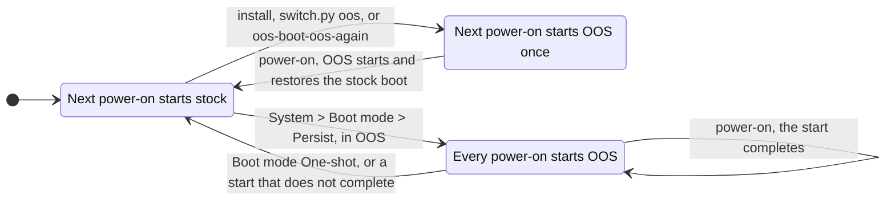

Check the first OOS start, choose which system boots next and check the card's speed.

## First start

1. After installing from USB or ADB, power-cycle the scope once the installer has selected OOS. If you
   installed on a second card, eject it from the computer, put it into the scope and close the instrument
   before switching on. Connect Ethernet if you want network access.
2. Watch for the Rigol logo, then the OOS start-up checklist and the scope screen. The checklist names any failed
   steps. With a missing calibration file, the scope runs on defaults and is less accurate.
3. Check that your calibration and saved settings are available. On a DHO924S with modified stock, both were
   preserved through a GEL reinstall on 2026-11-24.

The top bar shows the IP address. The scope uses DHCP if available and a link-local address otherwise.

## Choose how OOS starts

A fresh installation starts in **one-shot** mode. OOS restores the stock boot selection during startup, so the
next power-on starts stock.

To start OOS once more, run this in an SSH session (or on the serial console) and power-cycle the scope:

```sh
oos-boot-oos-again
```

When OOS works for you, make it the normal system: set **System > Boot mode** to **Persist**, or run
`oos-update mode persist` in the OOS shell. To switch back, select **One-shot** and power-cycle.

Even then, a start that does not complete leaves the stock boot in place, so the next power-on starts the stock system.

What the next power-on starts:



To leave OOS, see [[Going back to stock]].

## SD card speed after a GEL install

Expect the card to run in High Speed (HS) after a GEL install. If the image requests SDR104 and the card
negotiates HS, OOS shows “SD card is in slow mode”. A full power-off followed by a cold start restored SDR104
on the DHO924S on 2026-11-24. If you are in one-shot mode, select OOS for the next start first.

To select SDR104 for an installed OOS image, use the OOS shell.
See [SSH setup](https://github.com/yottabytesolutions/oos/blob/main/docs/network.md#7-ssh).

1. Check `oos-update status`. Restaging requires a tracked, confirmed image. Since 0.2.1, a GEL reinstall of
   the same tracked build keeps its tracking and rollback entry. If tracking is absent after a first install or
   a change of build via GEL, install a newer signed `.oosupd` and wait for confirmation.
2. Set `sd.mode = sdr104` in `/oos/system.conf`.
3. Run `oos-update sd-mode` to preview the change, then `oos-update sd-mode --execute` to stage it.
   Power-cycle to try the new mode.

See [Signed updates with rollback](https://github.com/yottabytesolutions/oos/blob/main/docs/update.md) and
[Device boot card mode](https://github.com/yottabytesolutions/oos/blob/main/docs/boot.md#device-boot-card-mode)
for trial confirmation, fallback and retry.
