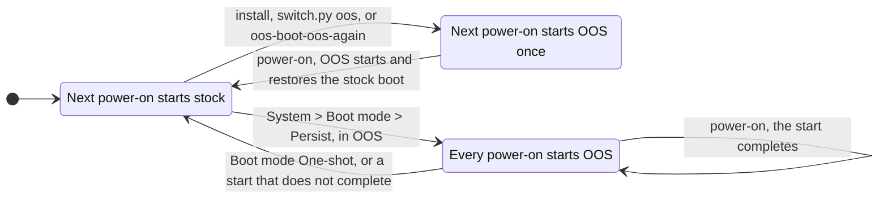

What the first start of OOS looks like, and how to choose whether the next power-on starts OOS or the stock system.

## First start

1. Eject the card, put it into the scope, close the instrument, connect Ethernet and switch on.
2. You see the Rigol logo from the stock loader, then the OOS start-up screen with a checklist.
3. The scope screen appears. Each failed step is named on the screen. A missing calibration file is a warning: the
   scope then runs on defaults and is less accurate.

The IP address comes from DHCP and is shown in the top bar. Without DHCP the scope takes a link-local address
(169.254.x.y, as computers do): a computer connected straight to the scope reaches it without any set-up.

## Choose how OOS starts

By default OOS is **one-shot**: every start of OOS restores the stock boot, so the **next power-on starts the stock
system**. This is the safe mode for a new installation.

To start OOS once more, run this in an SSH session (or on the serial console) and power-cycle the scope:

```sh
oos-boot-oos-again
```

When OOS works for you, make it the normal system: set **System > Boot mode** to **Persist**, or run
`oos-update mode persist`. It counts from the next power-on. One-shot goes back, and the next power-on starts stock.

Even then, a start that does not complete leaves the stock boot in place, so the next power-on starts the stock system.

What the next power-on starts:



To leave OOS, see [[Going back to stock]].
