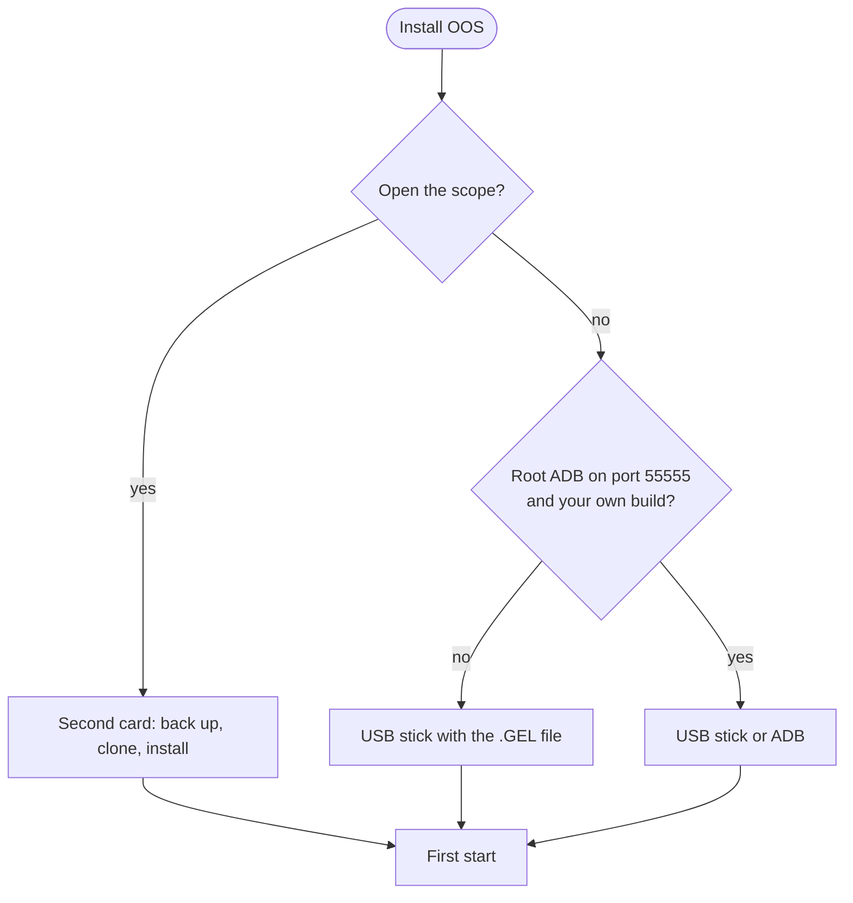

There are three ways to install OOS. Read the [[Disclaimer]] first, and keep a backup of your original card or its
rescue set.

| Way | Opens the scope | Your original card | State |
|---|---|---|---|
| [Second card](Install-on-a-second-card) | yes | stays untouched in a drawer | run on a DHO924S |
| [USB stick](Install-without-opening-the-scope#from-a-usb-stick) | no | OOS goes on it, beside stock | run on a DHO924S with a modified stock system |
| [ADB over the network](Install-without-opening-the-scope#over-adb) | no | OOS goes on it, beside stock | run on a DHO924S with a modified stock system |

The second card is the safe way: if anything goes wrong, the original card goes back in. Without opening the scope
there is no second card to fall back on ([read this first](Install-without-opening-the-scope#read-this-before-you-start)).

## Pages

- [[Install from a release]]: the ready-made files of a release and how to check them.
- [[Install on a second card]]: backup, clone and install, with the scope open.
- [[Install without opening the scope]]: from a USB stick or over ADB.
- [[Building OOS]]: build the kernel and the image yourself.
- [[First start and choosing how OOS starts]]: what happens next.
