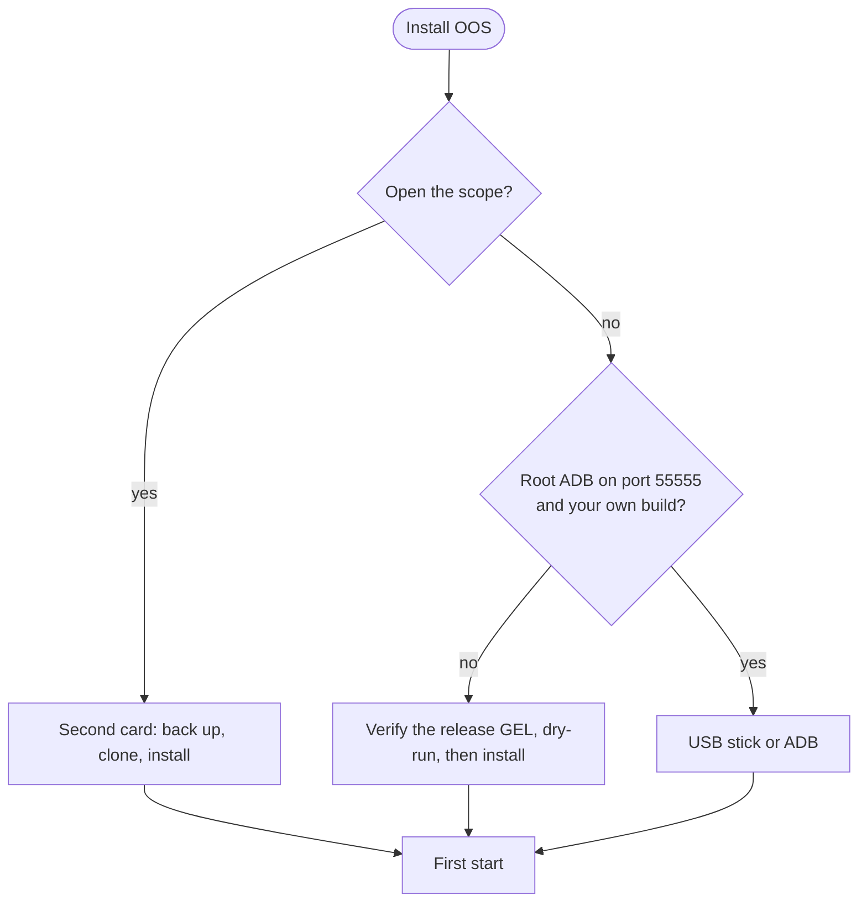

Read the [[Disclaimer]] before choosing an install route. Keep a backup of your original card or the rescue set
from the dry run.

| Way | Opens the scope | Your original card | State |
|---|---|---|---|
| [Second card](Install-on-a-second-card) | yes | stays untouched in a drawer | run on a DHO924S |
| [USB stick](Install-without-opening-the-scope#from-a-usb-stick) | no | OOS goes on it, beside stock | dry run and install verified on a DHO924S with modified stock on 2026-11-24 |
| [ADB over the network](Install-without-opening-the-scope#over-adb) | no | OOS goes on it, beside stock | run on a DHO924S with modified stock and root ADB on 2026-11-07 |

For the USB route, start with [[Install from a release]] to download the GEL and `SHA256SUMS`. The USB and ADB
routes are unverified with unmodified stock.

The second-card route lets you put the original card back if a start fails. With either in-place install, an
early boot hang can require opening the scope to recover. See
[Read this before you start](Install-without-opening-the-scope#read-this-before-you-start).

## Pages

- [[Install from a release]]
- [[Install on a second card]]
- [[Install without opening the scope]]
- [[Building OOS]]
- [[First start and choosing how OOS starts]]
